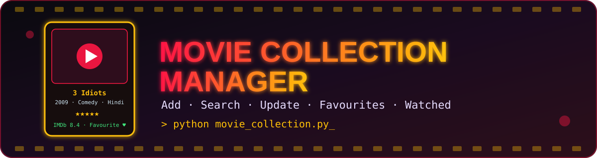

<div align="center">



<br/>


<h3>🎬 A beginner-friendly Python project to manage your personal movie collection 🎬</h3>

<p>
  <a href="#-features">Features</a> •
  <a href="#-movie-information">Movie Info</a> •
  <a href="#️-how-to-run">How to Run</a> •
  <a href="#-example">Example</a> •
  <a href="#-author">Author</a>
</p>

</div>

---

## 📖 About

A beginner-friendly Python project to manage a personal movie collection. Users can **add, view, search, update, and delete movies**, as well as display their **favourite and watched movies**.

This project is built using Python basics and helps improve programming logic and problem-solving skills.

---

## ✨ Features

| | Feature | Description |
|---|---|---|
| ➕ | **Add Movie** | Add new movies with their details |
| 👀 | **View All Movies** | Display all movies in the collection |
| 🔍 | **Search Movie** | Find a movie using its Movie ID |
| ✏️ | **Update Movie** | Update name, release year, genre, language, director, and ratings |
| 🗑️ | **Delete Movie** | Remove a movie after confirmation |
| ❤️ | **Show Favourite Movies** | Display movies marked as favourites |
| ✅ | **Show Watched Movies** | Display movies that have been watched |
| 🚪 | **Exit** | Close the program safely |

---

## 📋 Movie Information

The program stores the following details for each movie:

| # | Detail | # | Detail |
|---|---|---|---|
| 1 | Movie ID | 6 | Director Name |
| 2 | Movie Name | 7 | IMDb Rating |
| 3 | Release Year | 8 | Your Rating |
| 4 | Genre | 9 | Watched Status |
| 5 | Language | 10 | Favourite Status |

---

## 🛠️ Technologies Used

<p>
  
  
  
  
  
</p>

- Python 3
- Lists
- Dictionaries
- Functions
- While Loop
- For Loop
- If-Else Statements
- User Input and Type Casting
- List Methods
- String Methods

---

## 📂 Project Structure

```
Movie-Collection-Manager/
│
├── assets/
│   └── banner.svg
├── movie_collection.py
└── README.md
```

---

## ▶️ How to Run

**Step 1:** Install Python 3 if it is not already installed.

**Step 2:** Clone your repository.

```bash
git clone <your-repository-url>
```

**Step 3:** Open the project folder.

```bash
cd Movie-Collection-Manager
```

**Step 4:** Run the Python file.

```bash
python movie_collection.py
```

---

## 🖥️ Main Menu

```
========== MOVIE COLLECTION MANAGER ==========

1. Add Movie
2. View All Movies
3. Search Movie
4. Update Movie
5. Delete Movie
6. Show Favourite Movies
7. Show Watched Movies
8. Exit

Enter your choice:
```

---

## 💻 Example

### ➕ Add Movie

```
Enter your choice: 1

Enter Movie ID: 101
Enter Movie Name: 3 Idiots
Enter Release Year: 2009
Enter Genre: Comedy
Enter Language: Hindi
Enter Director Name: Rajkumar Hirani
Enter IMDb Rating: 8.4
Enter Your Rating: 9.5
Have you watched it? (yes/no): yes
Is it your favourite? (yes/no): yes

Movie added successfully!
```

### 👀 View All Movies

```
========== ALL MOVIES ==========

Movie ID     : 101
Movie Name   : 3 Idiots
Release Year : 2009
Genre        : Comedy
Language     : Hindi
Director     : Rajkumar Hirani
IMDb Rating  : 8.4
Your Rating  : 9.5
Watched      : yes
Favourite    : yes

-----------------------------------
Total Movies: 1
```

---

## 📚 Learning Objectives

Through this project, I practiced:

- Taking and processing user input.
- Creating and manipulating dictionaries.
- Storing multiple records in a list.
- Using functions to organize code.
- Implementing menu-driven programs with loops.
- Searching for records using conditions.
- Updating dictionary values.
- Deleting records from a list.
- Using flags to track search results.
- Building logical solutions to practical problems.

---

## 🚀 Future Improvements

- 🔹 Save movie data permanently using file handling.
- 🔹 Integrate an SQLite database.
- 🔹 Add sorting by rating or release year.
- 🔹 Search movies by name or genre.
- 🔹 Add input validation and exception handling.
- 🔹 Create a graphical user interface using Tkinter or PyQt.

---

## ⚠️ Limitations

- Movie details are stored in memory and are lost when the program closes.
- The program currently uses a terminal-based interface.
- Input validation can be improved.

---

## 👨‍💻 Author

<div align="center">

**Sudhanshu Dhande**
B.Tech Artificial Intelligence Student

### 📌 Project Status
**Completed — Python Basics Practice Project**
_Built to strengthen my understanding of Python fundamentals through hands-on practice._

</div>